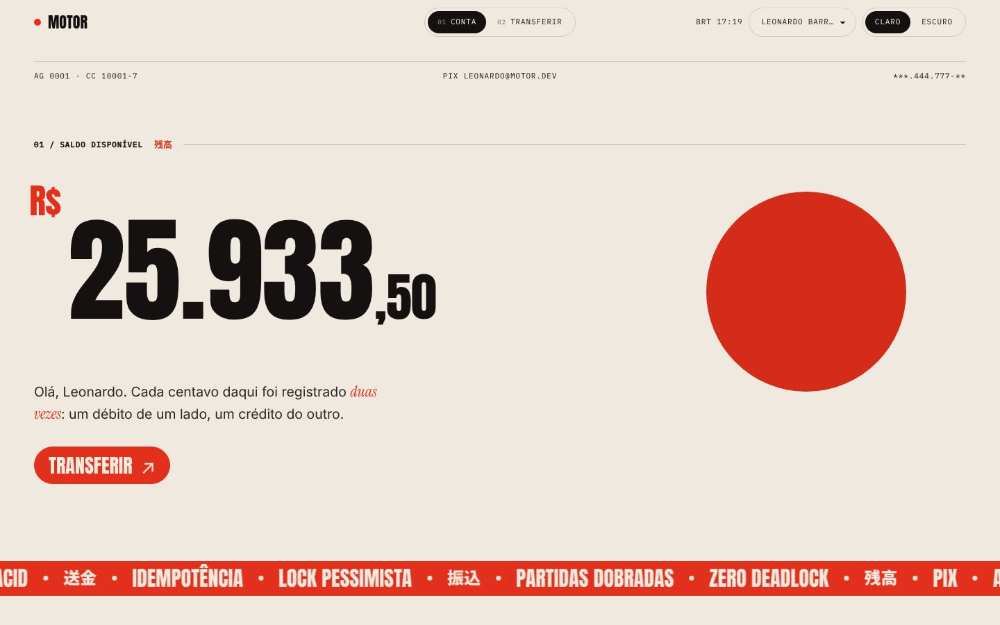
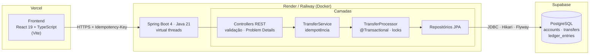
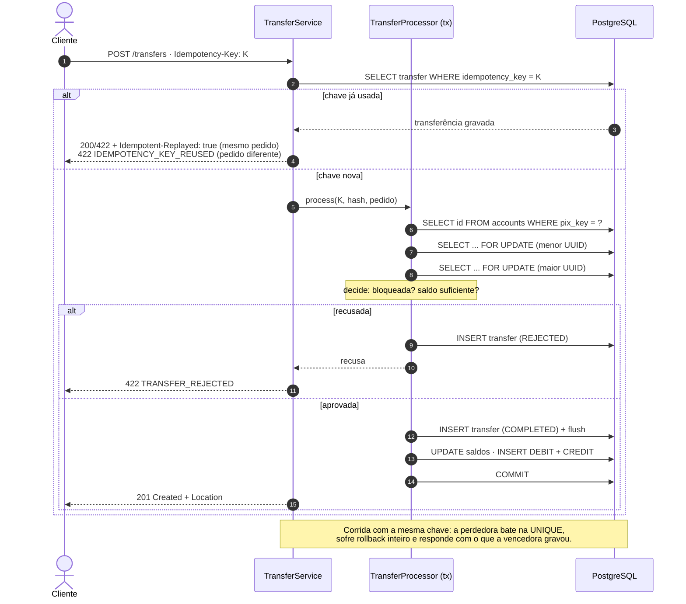
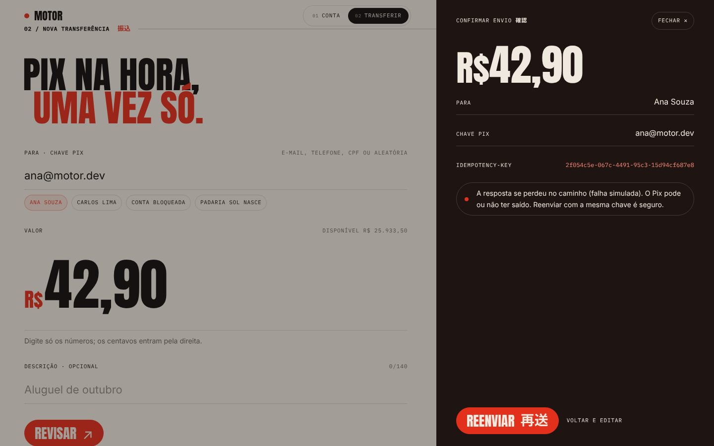
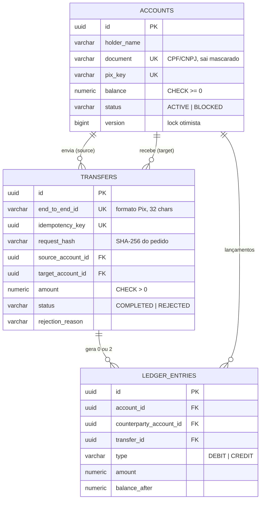
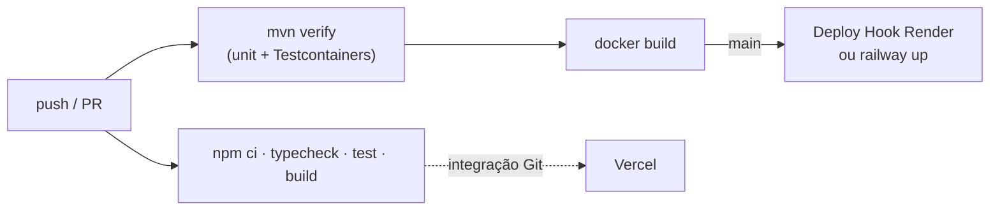
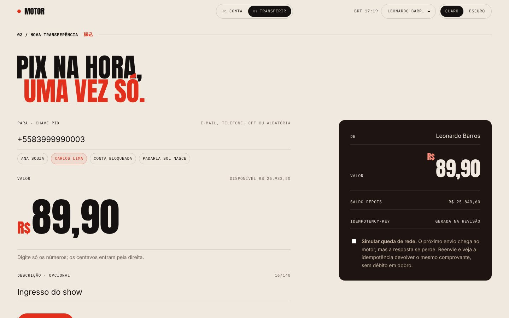
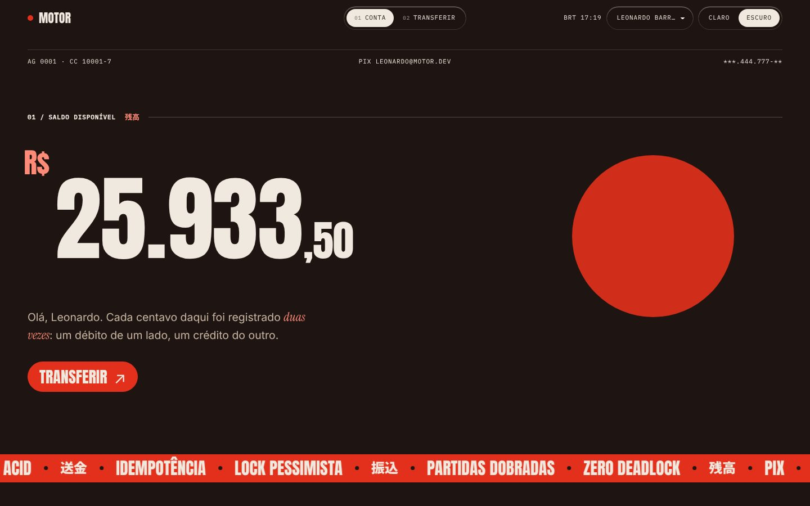

<div align="center">

# Motor de Transferências Financeiras

**Simulador de Pix e core bancário: transferências ACID, idempotentes e seguras sob concorrência.**

[](https://github.com/leonardobarrosx/motor-transferencias/actions/workflows/backend.yml)
[](https://github.com/leonardobarrosx/motor-transferencias/actions/workflows/frontend.yml)
[](LICENSE)


<br/>




</div>

---

## Sumário

- [O problema](#o-problema)
- [Destaques técnicos](#destaques-técnicos)
- [Arquitetura](#arquitetura)
- [Fluxo de uma transferência](#fluxo-de-uma-transferência)
- [Concorrência](#concorrência-por-que-o-saldo-nunca-fica-errado)
- [Idempotência](#idempotência-por-que-ninguém-paga-duas-vezes)
- [Modelo de dados](#modelo-de-dados)
- [API](#api)
- [Rodando localmente](#rodando-localmente)
- [Testes](#testes)
- [Deploy](#deploy)
- [Frontend e identidade visual](#frontend-e-identidade-visual)
- [Estrutura do repositório](#estrutura-do-repositório)
- [Decisões e próximos passos](#decisões-e-próximos-passos)

## O problema

Mover dinheiro entre duas contas parece um `UPDATE` de dois saldos. Em produção, três coisas tornam isso difícil:

1. **Concorrência.** Mil transferências por segundo, várias tocando a mesma conta. Duas leituras do mesmo saldo
   seguidas de duas escritas e um débito desaparece (*lost update*). Travar errado e as transações se esperam para
   sempre (*deadlock*).
2. **Falha parcial.** O servidor debita, a rede cai antes da resposta, o aplicativo tenta de novo. Sem cuidado, o
   cliente paga duas vezes.
3. **Auditoria.** "O saldo é X" não basta: é preciso provar como se chegou a X.

Este projeto resolve os três, com testes que provam cada garantia contra um PostgreSQL real.

## Destaques técnicos

| | |
|---|---|
| **ACID de ponta a ponta** | travar contas, decidir, debitar, creditar e gravar a ordem e os dois lançamentos acontece numa única transação: ou tudo, ou nada |
| **Lock pessimista ordenado** | `SELECT ... FOR UPDATE` nas duas contas, sempre pelo menor UUID primeiro (comparação sem sinal, igual à do Postgres): A→B e B→A simultâneas não entram em deadlock |
| **Idempotência real** | `Idempotency-Key` obrigatória, gravada com `UNIQUE` na própria transferência junto ao SHA-256 do pedido; reenvio devolve o resultado original com `Idempotent-Replayed: true` |
| **Livro-razão de partidas dobradas** | cada transferência gera um `DEBIT` e um `CREDIT` imutáveis com o saldo resultante; o extrato vem daqui e a soma explica cada saldo |
| **Defesa em profundidade** | domínio valida → lock pessimista → `@Version` otimista → `CHECK (balance >= 0)` e demais constraints no banco |
| **Dinheiro sem float** | `BigDecimal` com escala 2 e `RoundingMode.UNNECESSARY` no backend, centavos inteiros no frontend, string decimal no JSON (`"150.75"`), como a API Pix do Banco Central |
| **Erros padronizados** | Problem Details (RFC 9457) com `code` estável: `TRANSFER_REJECTED`, `IDEMPOTENCY_KEY_REUSED`, `ACCOUNT_BUSY`… |
| **Java 21 moderno** | records, `switch` de expressão, *virtual threads* (`spring.threads.virtual.enabled`), `Math.clamp`, `List.getFirst()` |
| **Testes que importam** | 42 testes; os de integração disparam dezenas de threads contra Postgres real via Testcontainers |

## Arquitetura



O backend é um monólito modular organizado **por domínio**, não por camada técnica:

| Pacote | Responsabilidade |
|---|---|
| `account` | entidade `Account`, consultas de saldo, extrato e movimento do mês |
| `transfer` | a transferência: `TransferService` (idempotência), `TransferProcessor` (transação e locks), `Transfer`, `EndToEndId` |
| `ledger` | lançamentos de partidas dobradas e a projeção do extrato |
| `shared` | `Money`, Problem Details, paginação, entidade com id atribuído no domínio |
| `config` | CORS, relógio injetável, OpenAPI |

## Fluxo de uma transferência



## Concorrência: por que o saldo nunca fica errado

1. **Ninguém lê o saldo sem trava.** O destino é resolvido pela chave Pix com uma consulta que devolve só o `id`.
   Carregar a entidade antes do lock deixaria no contexto de persistência um saldo velho, que o
   `SELECT ... FOR UPDATE` seguinte não atualizaria.
2. **As duas contas são travadas na mesma ordem.** Menor UUID primeiro, comparado sem sinal, como o Postgres ordena
   `uuid` (o `UUID.compareTo` do Java compara com sinal e divergiria). Sem ordem fixa, A→B e B→A travam uma conta
   cada e esperam a outra para sempre.
3. **`READ COMMITTED` + lock de linha.** Só quem disputa a mesma conta espera; transferências entre contas diferentes
   correm em paralelo. `SERIALIZABLE` abortaria transações sob disputa sem necessidade.
4. **Tempo máximo de espera.** `lock_timeout = 5s` por conexão: uma conta sobrecarregada vira `409 ACCOUNT_BUSY` com
   `Retry-After`, em vez de esgotar o pool. Repetir com a mesma chave é seguro.
5. **Segundas travas.** `@Version` na conta e `CHECK (balance >= 0)` no banco.

Detalhes e alternativas descartadas em [ADR 0001](docs/adr/0001-lock-pessimista-em-ordem-consistente.md).

## Idempotência: por que ninguém paga duas vezes

| Cenário | Resultado |
|---|---|
| Primeira requisição com a chave `K` | processa e grava a transferência com `K` e o hash do pedido |
| Mesma `K`, mesmo pedido (retry após timeout) | devolve a resposta original, `Idempotent-Replayed: true`, **sem novo débito** |
| Mesma `K`, pedido diferente | `422 IDEMPOTENCY_KEY_REUSED` |
| 20 requisições com `K` disparadas juntas | exatamente **uma** transferência e **um** débito |
| Recusada por saldo; a conta recebe dinheiro; retry com `K` | continua recusada: a decisão já foi tomada |

`"100"` e `"100.00"` produzem o mesmo hash; outra chave Pix ou outra descrição, não.
Detalhes em [ADR 0002](docs/adr/0002-idempotencia-por-chave-do-cliente.md).

> No frontend, ligue **Simular queda de rede** antes de enviar: o pedido chega ao motor, a resposta é descartada,
> e o reenvio com a mesma chave recebe o comprovante original.

<p align="center">
  
  
</p>

## Modelo de dados



Schema versionado com Flyway ([`V1__create_core_banking_schema.sql`](backend/src/main/resources/db/migration/V1__create_core_banking_schema.sql));
o Hibernate só **valida** (`ddl-auto: validate`) e derruba a aplicação se entidade e tabela divergirem.

## API

Documentação interativa em **`/swagger-ui.html`** (OpenAPI em `/v3/api-docs`).

| Método | Rota | Descrição |
|---|---|---|
| `POST` | `/api/v1/transfers` | realiza uma transferência Pix (header `Idempotency-Key` obrigatório) |
| `GET` | `/api/v1/transfers/{id}` | comprovante |
| `GET` | `/api/v1/accounts` | contas do simulador |
| `GET` | `/api/v1/accounts/{id}` | saldo, dados (documento mascarado) e movimento do mês |
| `GET` | `/api/v1/accounts/{id}/statement?page=0&size=20` | extrato paginado, do mais recente para o mais antigo |
| `GET` | `/actuator/health` | saúde (com `liveness` e `readiness`) |

```bash
curl -i -X POST http://localhost:8080/api/v1/transfers \
  -H "Content-Type: application/json" \
  -H "Idempotency-Key: $(uuidgen)" \
  -d '{
        "sourceAccountId": "0b0d8a52-6a0c-4c1e-9a3e-1f4f2a7d1001",
        "targetPixKey": "ana@motor.dev",
        "amount": "150.75",
        "description": "Aluguel de outubro"
      }'
```

```http
HTTP/1.1 201 Created
Location: http://localhost:8080/api/v1/transfers/0e588802-ce20-49cb-a55a-38efe5f55522
Idempotent-Replayed: false

{
  "id": "0e588802-ce20-49cb-a55a-38efe5f55522",
  "endToEndId": "E999999992026102120043UJ9225MLHG",
  "status": "COMPLETED",
  "amount": "150.75",
  "description": "Aluguel de outubro",
  "payer": { "accountId": "0b0d8a52-…1001", "holderName": "Leonardo Barros", "pixKey": "leonardo@motor.dev" },
  "payee": { "accountId": "0b0d8a52-…1002", "holderName": "Ana Souza", "pixKey": "ana@motor.dev" },
  "createdAt": "2026-10-21T20:04:44.831155Z"
}
```

<details>
<summary><b>Respostas de erro</b> (Problem Details, RFC 9457)</summary>

| HTTP | `code` | Quando |
|---|---|---|
| 400 | `VALIDATION_FAILED` | valor ≤ 0, mais de 2 casas decimais, chave Pix vazia… (com `errors[]` por campo) |
| 400 | `MISSING_PARAMETER` / `INVALID_PARAMETER` | `Idempotency-Key` ausente ou que não é UUID |
| 404 | `PIX_KEY_NOT_FOUND` / `ACCOUNT_NOT_FOUND` | destino ou origem inexistente |
| 409 | `ACCOUNT_BUSY` | lock não obtido em 5s; `Retry-After: 1`; repetir com a mesma chave é seguro |
| 422 | `TRANSFER_REJECTED` | `reason`: `INSUFFICIENT_FUNDS`, `SOURCE_ACCOUNT_BLOCKED`, `TARGET_ACCOUNT_BLOCKED` |
| 422 | `IDEMPOTENCY_KEY_REUSED` | chave já usada com outro pedido |
| 422 | `SAME_ACCOUNT_TRANSFER` | chave Pix de destino é da própria conta |

```json
{
  "type": "https://motor.dev/problems/transfer-rejected",
  "title": "Unprocessable Content",
  "status": 422,
  "detail": "Saldo insuficiente para esta transferência.",
  "code": "TRANSFER_REJECTED",
  "reason": "INSUFFICIENT_FUNDS",
  "transferId": "c31427e1-a75a-4e84-906b-325e85a1f344",
  "endToEndId": "E99999999202610212004O70ENWFUFCA"
}
```
</details>

## Rodando localmente

**Pré-requisitos:** Docker. Para rodar fora do Docker: JDK 21 e Node 22.

### Tudo com um comando

```bash
docker compose up --build
```

| Serviço | Endereço |
|---|---|
| API | http://localhost:8080 |
| Swagger UI | http://localhost:8080/swagger-ui.html |
| PostgreSQL | `localhost:5432` · banco/usuário/senha `motor` |

Com o perfil `demo`, o Flyway carrega cinco contas de exemplo (uma delas bloqueada, para ver a recusa).

### Backend sem Docker

```bash
docker compose up -d postgres          # ou aponte DATABASE_URL para outro Postgres
cd backend
SPRING_PROFILES_ACTIVE=demo ./mvnw spring-boot:run
```

### Frontend

```bash
cd frontend
npm install
cp .env.example .env.local             # VITE_API_URL=http://localhost:8080
npm run dev                            # http://localhost:5173
```

Sem `VITE_API_URL` o frontend roda em **modo demonstração**: um motor em memória no navegador, com as mesmas regras
(inclusive idempotência). É o que permite publicar o frontend na Vercel antes de existir backend.

### Variáveis de ambiente

| Variável | Padrão | Descrição |
|---|---|---|
| `DATABASE_URL` | `jdbc:postgresql://localhost:5432/motor` | URL JDBC |
| `DATABASE_USERNAME` / `DATABASE_PASSWORD` | `motor` | credenciais |
| `DATABASE_POOL_SIZE` | `10` | máximo de conexões do Hikari |
| `CORS_ALLOWED_ORIGINS` | `http://localhost:5173` | origens do frontend, separadas por vírgula |
| `SPRING_PROFILES_ACTIVE` | — | `demo` carrega as contas de exemplo |
| `PORT` | `8080` | porta HTTP (Render e Railway injetam) |
| `VITE_API_URL` (frontend) | — | URL da API; vazio = modo demonstração |

## Testes

```bash
cd backend && ./mvnw verify      # unitários + integração (precisa de Docker para o Testcontainers)
cd frontend && npm test          # vitest
```

| Suíte | Tipo | O que prova |
|---|---|---|
| `AccountTest` | unitário | débito/crédito, saldo nunca negativo, conta bloqueada não move dinheiro, frações de centavo recusadas, máscara de CPF/CNPJ |
| `TransferProcessorTest` | unitário (Mockito) | ordem de lock nos dois sentidos, ordem igual à do Postgres, recusas sem mexer em saldo, transferência gravada antes dos saldos, lançamentos com saldo resultante |
| `TransferServiceTest` | unitário (Mockito) | replay, chave reutilizada com outro pedido, corrida perdida devolve a vencedora, violação que não é de idempotência não é engolida |
| `TransferCommandTest` · `EndToEndIdTest` | unitário | hash do pedido normalizado; formato do end-to-end id do Pix |
| `TransferControllerTest` | slice `@WebMvcTest` | 201 + `Location`, 200 em replay, 422 em recusa, 409 com `Retry-After`, 400 sem chave/valor inválido, valor como string |
| `TransferConcurrencyIT` | integração (Postgres real) | 50 débitos simultâneos com saldo para 30 → exatamente 30; 60 transferências cruzadas A↔B → zero deadlock e dinheiro conservado; 20 envios simultâneos com a mesma chave → um débito; recusa idempotente; livro-razão explica cada saldo |
| `AccountStatementIT` | integração (Postgres real) | extrato ordenado com contraparte e saldo resultante; movimento do mês |
| `money.test.ts` | frontend (Vitest) | conversões string ↔ centavos sem float, máscara de caixa eletrônico |

Os relatórios do Surefire, Failsafe e JaCoCo (unitário e integração) ficam como artefato de cada execução da CI.

## Deploy



Workflows em [`.github/workflows`](.github/workflows): `backend.yml` testa, constrói a imagem e, na `main`, dispara o
deploy; `frontend.yml` garante typecheck, testes e build. Os passos de deploy se pulam sozinhos enquanto os segredos
não existem, então a CI fica verde desde o primeiro push.

### 1. Banco no Supabase

1. Crie um projeto em [supabase.com](https://supabase.com) (região `sa-east-1` para latência no Brasil).
2. Em *Connect*, copie a string do **Session pooler** (porta `5432`) e monte a URL JDBC:
   `jdbc:postgresql://aws-0-sa-east-1.pooler.supabase.com:5432/postgres?sslmode=require`
3. Usuário no formato `postgres.<project-ref>`. As tabelas são criadas pelo Flyway no primeiro boot.

> O *Transaction pooler* (porta `6543`) não mantém prepared statements entre transações; se usá-lo,
> acrescente `&prepareThreshold=0` à URL. Use pool pequeno (`DATABASE_POOL_SIZE=5`) no plano gratuito.

### 2. API no Render (ou Railway)

**Render:** *New → Blueprint* apontando para o repositório; o [`render.yaml`](render.yaml) cria o serviço Docker com
health check em `/actuator/health/readiness`. Preencha `DATABASE_URL`, `DATABASE_USERNAME`, `DATABASE_PASSWORD` e
`CORS_ALLOWED_ORIGINS`. Copie o *Deploy Hook* do serviço para o segredo **`RENDER_DEPLOY_HOOK_URL`** do GitHub:
o deploy passa a acontecer só depois que os testes passam.

**Railway:** crie um serviço a partir do repositório com *Root Directory* `backend` (o
[`railway.json`](backend/railway.json) usa o Dockerfile), configure as mesmas variáveis e, no GitHub, o segredo
**`RAILWAY_TOKEN`** e a variável **`RAILWAY_SERVICE`**.

### 3. Frontend na Vercel

*Add New → Project*, importe o repositório com *Root Directory* `frontend` (o preset Vite é detectado; ver
[`vercel.json`](frontend/vercel.json)) e defina `VITE_API_URL` com a URL da API. Sem ela, o deploy funciona em modo
demonstração.

## Frontend e identidade visual

O frontend aplica a identidade visual do meu portfólio
([`leonardobarrosx/leonardobarros-portfolio`](https://github.com/leonardobarrosx/leonardobarros-portfolio)): tokens
extraídos do código-fonte dele, não aproximados de captura de tela. Papel creme `#efe9df`, tinta vermelha `#e3301c`,
escuros de café `#1e1512`; Anton, Instrument Serif, IBM Plex Mono e Inter; grid de 12 colunas, rótulos
`01 / Seção ——— 漢字`, botões-pílula com tinta que sobe, pôsteres, disco vermelho, faixa corrida e grão de impressão.
CSS puro, sem framework: toda cor vem de [`tokens.css`](frontend/src/styles/tokens.css).

Mapa completo de tokens e componentes em [docs/DESIGN.md](docs/DESIGN.md).

<p align="center">
  
  
</p>
<p align="center">
  
</p>

## Estrutura do repositório

```
motor-transferencias/
├── backend/                                  Spring Boot 4 · Java 21
│   ├── src/main/java/dev/leonardobarros/motor/
│   │   ├── account/                          Account, AccountService, AccountController, AccountView
│   │   ├── transfer/                         TransferService (idempotência), TransferProcessor (tx + locks),
│   │   │                                     Transfer, TransferCommand, EndToEndId, TransferController
│   │   ├── ledger/                           LedgerEntry (partidas dobradas), StatementLine
│   │   ├── shared/                           Money, Problem Details, paginação, AssignedIdEntity
│   │   └── config/                           CORS, Clock, OpenAPI
│   ├── src/main/resources/
│   │   ├── application.yml
│   │   └── db/migration/ · db/seed/          Flyway: schema versionado e contas de demonstração
│   ├── src/test/java/…                       *Test (unitário, slice) e *IT (Testcontainers)
│   ├── Dockerfile                            multi-stage, camadas do Spring Boot, usuário sem privilégio
│   ├── railway.json
│   └── pom.xml · mvnw
├── frontend/                                 React 19 · TypeScript · Vite · CSS puro
│   ├── src/
│   │   ├── api/                              cliente HTTP, motor de demonstração, tipos
│   │   ├── screens/                          Dashboard (conta), Transfer (envio, confirmação, comprovante)
│   │   ├── components/                       Nav, Label, Amount, Marquee
│   │   ├── hooks/                            rota, esquema claro/escuro, preferências, relógio de Brasília
│   │   ├── lib/money.ts                      centavos inteiros, nunca float
│   │   └── styles/                           tokens.css (do portfólio) · app.css
│   └── vercel.json
├── docs/
│   ├── adr/                                  decisões de arquitetura
│   ├── DESIGN.md                             identidade visual extraída do portfólio
│   └── screenshots/
├── .github/workflows/                        backend.yml · frontend.yml
├── docker-compose.yml
└── render.yaml
```

## Decisões e próximos passos

**Fora do escopo, de propósito:** autenticação (qualquer cliente vê qualquer conta no simulador), limites Pix
(diurno/noturno), agendamento e estorno.

**Próximos passos:**

- [ ] Autenticação OAuth2/JWT e escopo da `Idempotency-Key` por cliente
- [ ] Estorno (MED) como nova transferência de sentido contrário, nunca `UPDATE` no livro-razão
- [ ] Limites por período e horário, com regra configurável
- [ ] Outbox transacional publicando `TransferCompleted` para notificações
- [ ] Expiração das chaves de idempotência (job diário)
- [ ] Métricas (Micrometer + Prometheus) e tracing (OpenTelemetry)
- [ ] Teste de carga com k6 e relatório de throughput por conta

---

<div align="center">

Feito por **Leonardo Barros** · [MIT](LICENSE)

</div>
