<div align="center">

# Motor de Transferências

**Core bancário e Pix em Java 21: transferências ACID, idempotentes e autenticadas, com microsserviços orientados a eventos em Kafka e Apache Camel.**

[](https://github.com/leonardobarrosx/motor-transferencias/actions/workflows/backend.yml)
[](https://github.com/leonardobarrosx/motor-transferencias/actions/workflows/integracoes.yml)
[](https://github.com/leonardobarrosx/motor-transferencias/actions/workflows/frontend.yml)
[](LICENSE)


<br/>


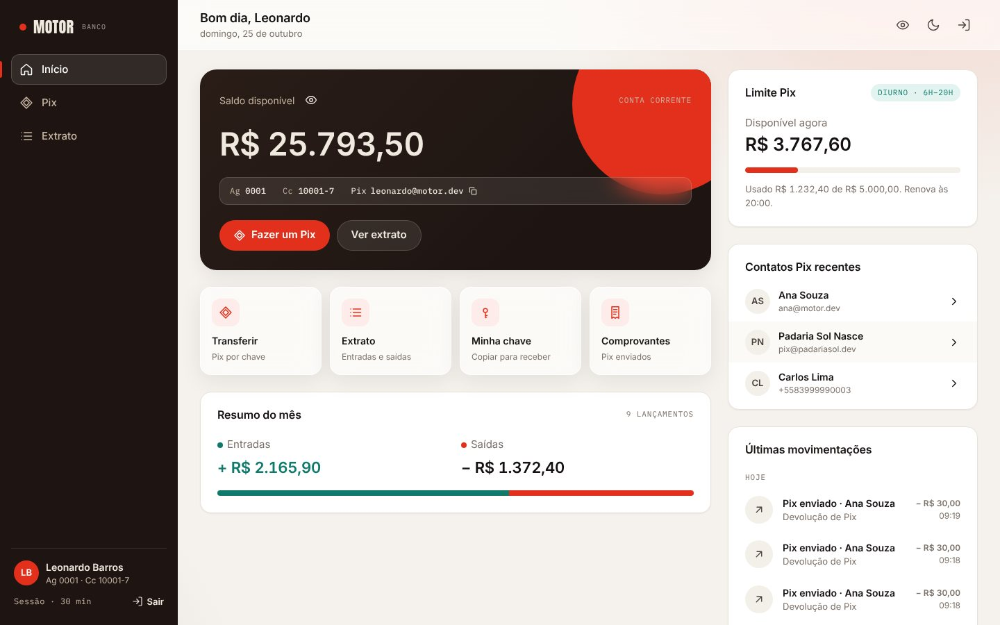

> [!NOTE]
> **Projeto de estudo, open source, sem uso real.** Não foi feito para nenhum cliente nem processa dinheiro de verdade.
> Nomes, CPFs (com dígito verificador inválido de propósito), chaves Pix e o ISPB `99999999` são fictícios. As regras
> de Pix seguem a documentação pública do Banco Central, mas o projeto não tem vínculo com o BCB nem com o SPI.

**Contas de demonstração:** `leonardo@motor.dev` · `ana@motor.dev` · `carlos@motor.dev` · `bloqueada@motor.dev`, senha `motor123`

</div>

---

## Sumário

- [O que este projeto demonstra](#o-que-este-projeto-demonstra)
- [O problema](#o-problema)
- [Arquitetura](#arquitetura)
- [Fluxo de uma transferência](#fluxo-de-uma-transferência)
- [Concorrência](#concorrência-por-que-o-saldo-nunca-fica-errado)
- [Idempotência](#idempotência-por-que-ninguém-paga-duas-vezes)
- [Segurança](#segurança)
- [Limites Pix e devolução](#limites-pix-e-devolução)
- [Microsserviços e eventos (Kafka + Camel)](#microsserviços-e-eventos-kafka--camel)
- [Modelo de dados](#modelo-de-dados)
- [API](#api)
- [Rodando localmente](#rodando-localmente)
- [Testes](#testes)
- [Deploy](#deploy)
- [Frontend](#frontend)
- [Estrutura do repositório](#estrutura-do-repositório)
- [Limites conhecidos e próximos passos](#limites-conhecidos-e-próximos-passos)

## O que este projeto demonstra

O que uma vaga de **desenvolvedor Java pleno** costuma pedir, e onde está no código:

| Requisito comum | Onde ver |
|---|---|
| Java moderno (17+/21) | `record`, `switch` de expressão, *virtual threads*, `Math.clamp`, pattern matching em `instanceof` |
| Spring Boot, REST, validação | controllers enxutos, Bean Validation nos DTOs, Problem Details (RFC 9457) com `code` estável |
| Microsserviços | `motor-transferencias` (núcleo financeiro) e `motor-integracoes` (Camel), ligados só pelo Kafka ([ADR 0004](docs/adr/0004-eventos-com-outbox-kafka-e-camel.md)) |
| Kafka | outbox transacional, relay com `SKIP LOCKED`, `acks=all`, chave por conta para ordem por partição, DLQ, consumer group |
| Apache Camel | rotas com EIPs: Idempotent Consumer, Content-Based Router, Multicast, Splitter, Aggregator, Dead Letter Channel; ISO 20022 pacs.008 e pacs.004 |
| Spring Security e JWT | login com BCrypt, resource server stateless, `@CurrentAccount` resolvendo a conta pelo token ([ADR 0003](docs/adr/0003-autenticacao-jwt-e-conta-do-token.md)) |
| JPA/Hibernate e SQL | entidade com regras, projeções JPQL sem N+1, lock pessimista, `@Version`, constraints no banco |
| Transações e consistência | uma transação ACID por transferência, livro-razão de partidas dobradas |
| Concorrência | lock em ordem consistente contra deadlock ([ADR 0001](docs/adr/0001-lock-pessimista-em-ordem-consistente.md)) |
| Regras de negócio de banco | limite Pix diurno/noturno do BCB e devolução parcial, as duas seguras sob concorrência ([ADR 0005](docs/adr/0005-limites-pix-e-devolucao.md)) |
| Design de API resiliente | `Idempotency-Key` com replay e detecção de reuso ([ADR 0002](docs/adr/0002-idempotencia-por-chave-do-cliente.md)) |
| Migrações versionadas | Flyway + `ddl-auto: validate` |
| Testes unitários e de integração | JUnit 5, Mockito, `@WebMvcTest`, Camel test com mocks, Testcontainers com Postgres e Kafka reais: **83 testes** em Java + 10 no front |
| Docker, CI/CD, nuvem | Dockerfile multi-stage, GitHub Actions, Render/Railway, Supabase, Vercel |
| Documentação | este README, OpenAPI/Swagger, contrato de eventos, cinco ADRs |

## O problema

Mover dinheiro entre duas contas parece um `UPDATE` de dois saldos. Em produção, quatro coisas tornam isso difícil:

1. **Concorrência.** Duas transferências leem o mesmo saldo e as duas debitam sobre o valor antigo: um débito some
   (*lost update*). Travando errado, as transações se esperam para sempre (*deadlock*).
2. **Falha parcial.** O servidor debita, a rede cai antes da resposta, o app reenvia: a pessoa paga duas vezes.
3. **Acesso indevido.** Se a conta de origem vem do corpo da requisição, basta trocar um id para debitar outra
   pessoa (IDOR).
4. **Auditoria.** "O saldo é X" não basta: é preciso provar como se chegou a X.

O motor resolve os quatro, com testes que provam cada garantia contra um PostgreSQL real.

## Arquitetura

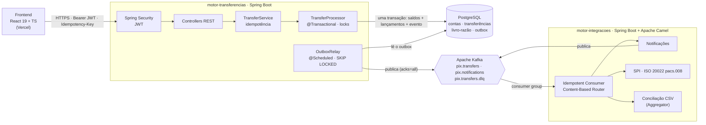

Dois microsserviços. O núcleo financeiro é um monólito modular organizado **por domínio**:

| Pacote | Responsabilidade |
|---|---|
| `auth` | usuários, login, emissão do JWT, `@CurrentAccount` |
| `account` | conta, saldo, extrato, contatos recentes (`/me`) |
| `pix` | consulta do dono de uma chave Pix antes de transferir |
| `transfer` | a transferência: idempotência (`TransferService`), transação e locks (`TransferProcessor`) |
| `ledger` | lançamentos de partidas dobradas |
| `outbox` | evento gravado na transação da transferência e relay que publica no Kafka |
| `shared` | `Money`, Problem Details, paginação |
| `config` | Spring Security, CORS, relógio injetável, OpenAPI |

## Fluxo de uma transferência

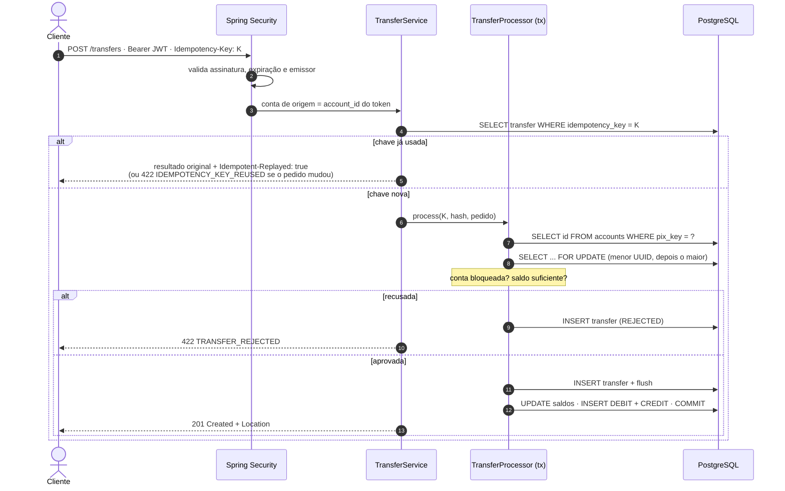

## Concorrência: por que o saldo nunca fica errado

1. **Ninguém lê o saldo sem trava.** O destino é resolvido pela chave Pix com uma consulta que devolve só o `id`.
2. **As duas contas são travadas na mesma ordem**, menor UUID primeiro, com comparação sem sinal igual à do Postgres
   (o `UUID.compareTo` do Java compara com sinal e divergiria). Sem ordem fixa, A→B e B→A entrariam em deadlock.
3. **`READ COMMITTED` + lock de linha.** Só quem disputa a mesma conta espera; contas diferentes correm em paralelo.
4. **Tempo máximo de espera.** `lock_timeout = 5s`: conta sobrecarregada vira `409 ACCOUNT_BUSY` com `Retry-After`.
5. **Segundas travas.** `@Version` na conta e `CHECK (balance >= 0)` no banco.

Detalhes e alternativas em [ADR 0001](docs/adr/0001-lock-pessimista-em-ordem-consistente.md).

## Idempotência: por que ninguém paga duas vezes

| Cenário | Resultado |
|---|---|
| Primeira requisição com a chave `K` | processa e grava a transferência com `K` e o hash do pedido |
| Mesma `K`, mesmo pedido (retry após timeout) | devolve a resposta original com `Idempotent-Replayed: true`, **sem novo débito** |
| Mesma `K`, pedido diferente | `422 IDEMPOTENCY_KEY_REUSED` |
| 20 requisições com `K` disparadas juntas | exatamente **uma** transferência e **um** débito |
| Recusada por saldo; a conta recebe dinheiro; retry com `K` | continua recusada: a decisão já foi tomada |

Detalhes em [ADR 0002](docs/adr/0002-idempotencia-por-chave-do-cliente.md). No front, a revisão do Pix tem
**Simular queda de rede**: o pedido chega ao servidor, a resposta é descartada, e o reenvio recebe o comprovante original.

<p align="center">
  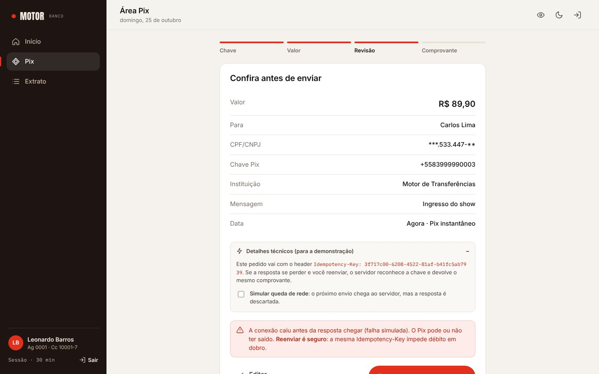
  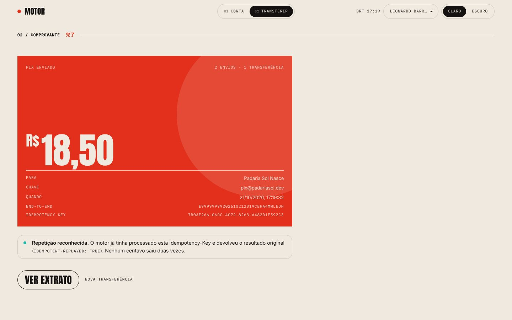
</p>

## Segurança

| Medida | Como |
|---|---|
| Senha | só o hash BCrypt (custo 10) é gravado |
| Autenticação | `POST /api/v1/auth/login` devolve um JWT HS256 de 30 min (`sub`, `account_id`, `iss`) |
| Validação do token | Spring Security como resource server: assinatura, expiração e emissor em toda requisição |
| Sem IDOR | a conta sai do token via `@CurrentAccount`; rotas de conta são `/me/**`; não existe rota que receba o id de outra conta |
| Comprovante | só quem enviou ou recebeu vê; os demais recebem 404 (um 403 confirmaria que o id existe) |
| Sem enumeração de usuários | e-mail inexistente e senha errada têm a mesma resposta e o mesmo custo de BCrypt |
| Dados pessoais | CPF/CNPJ mascarados (`***.444.777-**`) e conta parcial (`•••02-5`) em toda resposta |
| Configuração | segredo do JWT com menos de 32 bytes derruba o boot; CORS restrito às origens do front |

Decisões e alternativas em [ADR 0003](docs/adr/0003-autenticacao-jwt-e-conta-do-token.md).

## Limites Pix e devolução

Duas regras que todo banco brasileiro tem, e que só são difíceis por causa da concorrência.

**Limite por período.** Como manda o Banco Central, o limite é menor à noite: **R$ 5.000 das 6h às 20h** e
**R$ 1.000 das 20h às 6h**, no horário de Brasília. A janela noturna atravessa a meia-noite (às 2h ela começou às 20h
de ontem). O "já usado" é somado **com a conta pagadora travada**: dez Pix simultâneos de R$ 150 à noite resultam em
exatamente 6 concluídos e 4 recusados com `LIMIT_EXCEEDED`, nunca 7. O app mostra o limite disponível na tela inicial
e avisa antes de o cliente tentar passar dele.

**Devolução.** Quem recebeu pode devolver o Pix, inteiro ou em partes, em até 90 dias. A devolução é **uma
transferência nova** no sentido contrário (`kind = REFUND`, end-to-end id começando com `D`), com seus próprios
lançamentos: o livro-razão nunca é editado. A soma devolvida é conferida com as duas contas travadas, então oito
devoluções simultâneas de R$ 30 sobre um Pix de R$ 100 resultam em exatamente 3. No `motor-integracoes`, a devolução
vira uma mensagem ISO 20022 **pacs.004** com o motivo (`MD06`, `FR01`, `BE08`) e o E2E do Pix original.

<p align="center">
  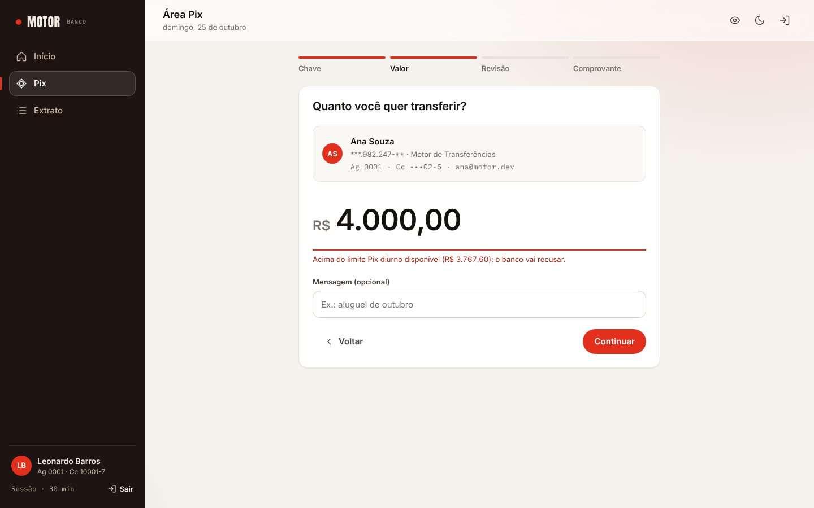
  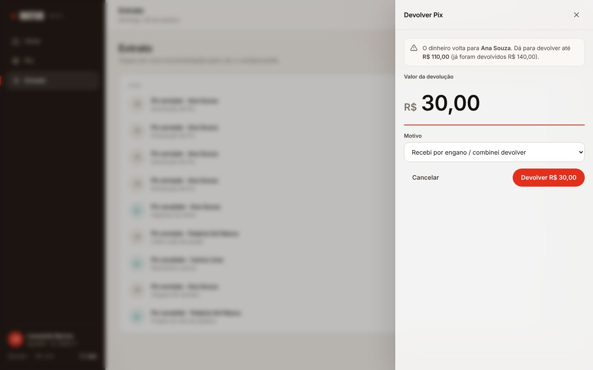
</p>

Decisões e alternativas em [ADR 0005](docs/adr/0005-limites-pix-e-devolucao.md).

## Microsserviços e eventos (Kafka + Camel)

Depois de um Pix, outras coisas precisam acontecer: avisar quem pagou e quem recebeu, enviar a ordem ao sistema de
liquidação e gerar a conciliação. Nada disso pode atrasar ou derrubar a transferência. Por isso:

- **O dinheiro fica num serviço só.** Débito, crédito e lançamentos continuam numa transação ACID no
  `motor-transferencias`. Separar as contas em serviços trocaria essa transação por uma saga com compensação.
- **O resto reage a eventos** no `motor-integracoes`, ligado ao núcleo apenas pelo Kafka. Se ele cair, nenhum Pix
  deixa de ser concluído; quando volta, continua do offset onde parou.
- **Outbox transacional.** O evento é gravado na mesma transação da transferência e publicado por um relay. Rollback
  desfaz os dois; Kafka fora do ar só atrasa a publicação. Entrega pelo menos uma vez, com o consumidor deduplicando
  por `eventId`.

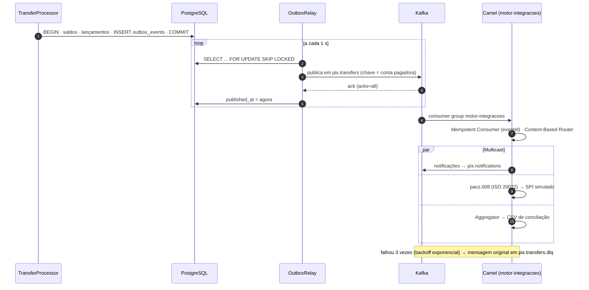

| EIP (Camel) | Para quê |
|---|---|
| Idempotent Consumer | o outbox entrega pelo menos uma vez; o mesmo `eventId` é processado uma vez só |
| Content-Based Router | Pix concluído e Pix recusado seguem caminhos diferentes |
| Multicast | um Pix liquidado alimenta notificação, SPI e conciliação |
| Message Translator | evento → notificação em português; evento → XML ISO 20022 **pacs.008** |
| Splitter | uma transferência gera uma notificação por pessoa |
| Aggregator | Pix liquidados agrupados num CSV de conciliação (fecha por quantidade ou por tempo) |
| Dead Letter Channel | mensagem envenenada vai para a DLQ sem travar a partição |

Contrato dos eventos em [docs/EVENTOS.md](docs/EVENTOS.md); decisões e alternativas (Debezium, 2PC, `@KafkaListener`,
RabbitMQ) em [ADR 0004](docs/adr/0004-eventos-com-outbox-kafka-e-camel.md).

<p align="center">
  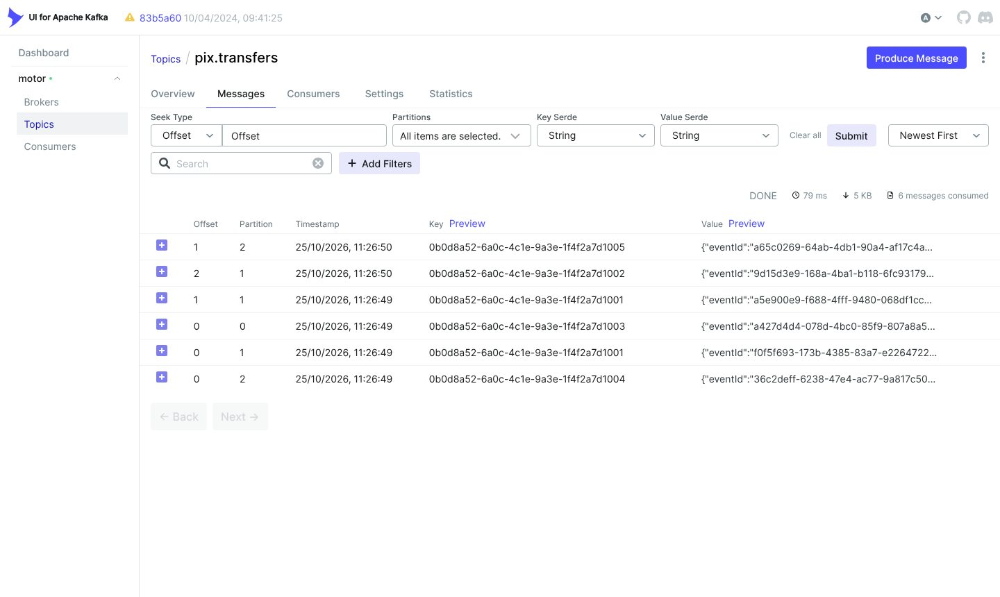
  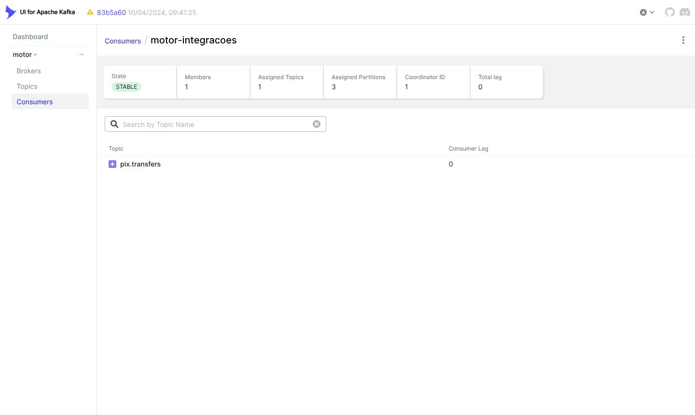
</p>

## Modelo de dados

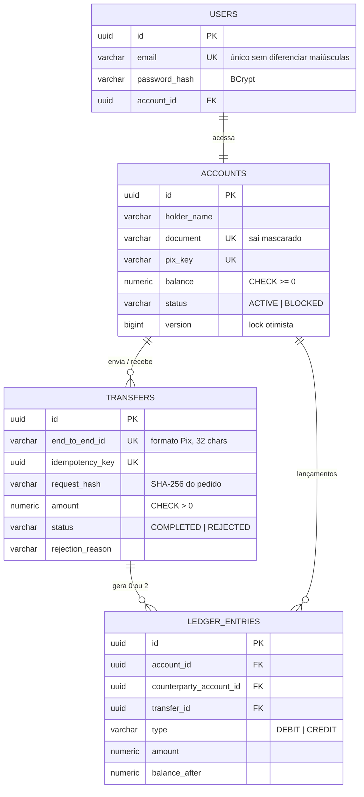

Schema versionado com Flyway em [`db/migration`](backend/src/main/resources/db/migration); o Hibernate só
**valida** (`ddl-auto: validate`).

## API

Documentação interativa em **`/swagger-ui.html`**: faça o login, copie o `accessToken` e use **Authorize**.

| Método | Rota | Descrição |
|---|---|---|
| `POST` | `/api/v1/auth/login` | e-mail + senha → JWT (pública) |
| `GET` | `/api/v1/me` | saldo, dados da conta e movimento do mês |
| `GET` | `/api/v1/me/statement?type=CREDIT\|DEBIT&page=0&size=20` | extrato paginado, filtrável |
| `GET` | `/api/v1/me/contacts` | contatos Pix recentes |
| `GET` | `/api/v1/me/limits` | limite Pix do período atual: limite, usado, disponível e quando renova |
| `GET` | `/api/v1/pix/keys/{chave}` | dono da chave (nome, documento mascarado, instituição) antes de transferir |
| `POST` | `/api/v1/transfers` | realiza um Pix (header `Idempotency-Key` obrigatório) |
| `POST` | `/api/v1/transfers/{id}/refunds` | devolve um Pix recebido, total ou parcial (`amount`, `reason`; `Idempotency-Key` obrigatório) |
| `GET` | `/api/v1/transfers/{id}` | comprovante (só de quem enviou ou recebeu) |
| `GET` | `/actuator/health` | saúde, com `liveness` e `readiness` (pública) |

```bash
# 1. login
TOKEN=$(curl -s -X POST http://localhost:8080/api/v1/auth/login \
  -H "Content-Type: application/json" \
  -d '{"email": "leonardo@motor.dev", "password": "motor123"}' | jq -r .accessToken)

# 2. Pix: a conta de origem vem do token
curl -i -X POST http://localhost:8080/api/v1/transfers \
  -H "Authorization: Bearer $TOKEN" \
  -H "Content-Type: application/json" \
  -H "Idempotency-Key: $(uuidgen)" \
  -d '{"targetPixKey": "ana@motor.dev", "amount": "150.75", "description": "Aluguel de outubro"}'
```

```http
HTTP/1.1 201 Created
Location: http://localhost:8080/api/v1/transfers/0e588802-ce20-49cb-a55a-38efe5f55522
Idempotent-Replayed: false

{
  "id": "0e588802-ce20-49cb-a55a-38efe5f55522",
  "endToEndId": "E999999992026102120043UJ9225MLHG",
  "status": "COMPLETED",
  "amount": "150.75",
  "payer": { "holderName": "Leonardo Barros", "pixKey": "leonardo@motor.dev", "...": "..." },
  "payee": { "holderName": "Ana Souza", "pixKey": "ana@motor.dev", "...": "..." },
  "createdAt": "2026-10-21T20:04:44.831155Z"
}
```

<details>
<summary><b>Respostas de erro</b> (Problem Details, RFC 9457)</summary>

| HTTP | `code` | Quando |
|---|---|---|
| 400 | `VALIDATION_FAILED` | valor ≤ 0, mais de 2 casas decimais, campo vazio… (com `errors[]` por campo) |
| 400 | `MISSING_PARAMETER` / `INVALID_PARAMETER` | `Idempotency-Key` ausente ou que não é UUID |
| 401 | `UNAUTHENTICATED` | sem token, token expirado ou adulterado |
| 401 | `INVALID_CREDENTIALS` | e-mail ou senha incorretos |
| 404 | `PIX_KEY_NOT_FOUND` / `TRANSFER_NOT_FOUND` | chave inexistente; comprovante inexistente ou de outra conta |
| 409 | `ACCOUNT_BUSY` | lock não obtido em 5s; `Retry-After: 1`; repetir com a mesma chave é seguro |
| 422 | `TRANSFER_REJECTED` | `reason`: `INSUFFICIENT_FUNDS`, `SOURCE_ACCOUNT_BLOCKED`, `TARGET_ACCOUNT_BLOCKED`, `LIMIT_EXCEEDED` |
| 422 | `REFUND_NOT_ALLOWED` / `REFUND_WINDOW_EXPIRED` / `REFUND_AMOUNT_EXCEEDED` | devolução por quem pagou, de algo que não é Pix concluído, após 90 dias, ou acima do que resta |
| 422 | `IDEMPOTENCY_KEY_REUSED` | chave já usada com outro pedido |
| 422 | `SAME_ACCOUNT_TRANSFER` | chave Pix de destino é da própria conta |

</details>

## Rodando localmente

**Pré-requisito:** Docker. Para rodar fora do Docker: JDK 21 e Node 22.

```bash
docker compose up --build                 # Postgres + Kafka + os dois microsserviços + Kafka UI
```

| Serviço | Endereço |
|---|---|
| API (`motor-transferencias`) | http://localhost:8080 · Swagger em `/swagger-ui.html` |
| Integrações (`motor-integracoes`) | http://localhost:8081/api/notificacoes · `/api/spi/mensagens` |
| Kafka UI | http://localhost:8090 |
| Kafka | `localhost:9092` (tópicos criados pelo serviço `kafka-init`) |
| PostgreSQL | `localhost:5432` · banco/usuário/senha `motor` |

**Serviços sem Docker** (infraestrutura no Docker, código na IDE)

```bash
docker compose up -d postgres kafka kafka-init kafka-ui
cd backend && SPRING_PROFILES_ACTIVE=demo OUTBOX_RELAY_ENABLED=true ./mvnw spring-boot:run
cd integracoes && ./mvnw spring-boot:run
```

**Frontend**

```bash
cd frontend
npm install
cp .env.example .env.local                # VITE_API_URL=http://localhost:8080
npm run dev                               # http://localhost:5173
```

Sem `VITE_API_URL`, o front roda em **modo demonstração**: um motor em memória no navegador com as mesmas regras
(login, idempotência, recusas). Assim dá para publicar na Vercel antes de existir backend.

| Variável | Padrão | Descrição |
|---|---|---|
| `DATABASE_URL` | `jdbc:postgresql://localhost:5432/motor` | URL JDBC |
| `DATABASE_USERNAME` / `DATABASE_PASSWORD` | `motor` | credenciais |
| `DATABASE_POOL_SIZE` | `10` | máximo de conexões do Hikari |
| `JWT_SECRET` | segredo de desenvolvimento | chave HMAC, mínimo 32 bytes (`openssl rand -base64 48`) |
| `JWT_TTL` | `30m` | validade do token |
| `CORS_ALLOWED_ORIGINS` | `http://localhost:5173` | origens do front, separadas por vírgula |
| `SPRING_PROFILES_ACTIVE` | — | `demo` carrega contas e usuários de exemplo |
| `KAFKA_BOOTSTRAP_SERVERS` | `localhost:9092` | brokers do Kafka (os dois serviços) |
| `OUTBOX_RELAY_ENABLED` | `false` | liga a publicação do outbox no Kafka; desligado, a API roda sem Kafka e os eventos esperam |
| `PORT` | `8080` / `8081` | porta HTTP |
| `VITE_API_URL` (front) | — | URL da API; vazio = modo demonstração |

## Testes

```bash
cd backend && ./mvnw verify       # 72 testes: unitários + integração com Postgres e Kafka reais (Testcontainers)
cd integracoes && ./mvnw verify   # 11 testes: rotas Camel, pacs.008/pacs.004, notificações
cd frontend && npm test           # 10 testes Vitest
```

| Suíte | Tipo | O que prova |
|---|---|---|
| `PixLimitsTest` (6) | unitário | janelas diurna e noturna nas bordas (05:59:59, 06:00, 19:59:59, 20:00) e a noite que começou ontem |
| `LimitsAndRefundsIT` (5) | integração · Postgres real | 10 Pix simultâneos contra o limite noturno → exatamente 6; 8 devoluções simultâneas → exatamente 3; só quem recebeu devolve; devolução idempotente |
| `TransferProcessorTest` (11) | unitário · Mockito | ordem de lock nos dois sentidos e igual à do Postgres; recusas sem mexer em saldo; transferência gravada antes dos saldos |
| `TransferServiceTest` (5) | unitário · Mockito | replay; chave reutilizada com outro pedido; corrida perdida devolve a vencedora |
| `AuthServiceTest` (3) | unitário · Mockito | login válido; senha errada; e-mail inexistente com a mesma resposta e o mesmo custo de hash |
| `PixKeyServiceTest` (5) | unitário · Mockito | dados mascarados; conta bloqueada; chave própria; chave inexistente |
| `AccountTest` · `TransferCommandTest` · `EndToEndIdTest` (10) | unitário | regras de saldo; hash do pedido normalizado; formato do end-to-end id |
| `TransferControllerTest` (12) | `@WebMvcTest` + Spring Security | 201/200/422/409/400/401; `sourceAccountId` forjado no corpo é ignorado |
| `TransferConcurrencyIT` (4) | integração · Postgres real | 50 débitos simultâneos com saldo para 30 → exatamente 30; 60 cruzadas A↔B sem deadlock; mesma chave 20× → um débito; livro-razão explica cada saldo |
| `AccountStatementIT` (4) | integração · Postgres real | extrato ordenado e filtrado; contatos recentes; movimento do mês |
| `ApiSecurityIT` (4) | integração · HTTP + Postgres real | jornada completa com login; token com payload adulterado → 401; comprovante de terceiro → 404 |
| `OutboxRelayIT` (2) | integração · Postgres + Kafka reais | Pix concluído e recusado publicados com a conta pagadora como chave; transferência que falha não deixa evento |
| `RotasPixTest` (6) | Camel · rotas reais com mocks | notificação + pacs.008; devolução → pacs.004 com o E2E original; evento repetido processado uma vez; recusa só notifica o pagador; Aggregator fecha o CSV; mensagem envenenada vai para a DLQ e a seguinte passa |
| `Pacs008Test` · `ComposicaoNotificacoesTest` (5) | unitário | XML ISO 20022 bem formado e com escape; CPF → `PrvtId`, CNPJ → `OrgId`; textos das notificações |
| `money.test.ts` · `limits.test.ts` (10) | front · Vitest | dinheiro em centavos inteiros, sem float; janela de limite no horário de Brasília |

## Deploy

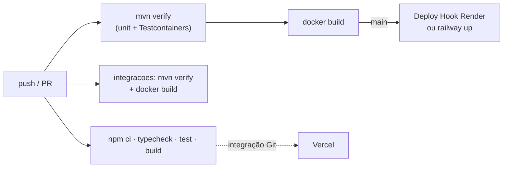

1. **Banco no Supabase.** Crie o projeto (região `sa-east-1`), copie a string do **Session pooler** (porta 5432) e
   monte `jdbc:postgresql://aws-0-sa-east-1.pooler.supabase.com:5432/postgres?sslmode=require`. As tabelas são
   criadas pelo Flyway no primeiro boot. O *Transaction pooler* (porta 6543) exige `&prepareThreshold=0` na URL.
2. **API no Render.** *New → Blueprint* apontando para o repositório: o [`render.yaml`](render.yaml) cria o serviço
   Docker, gera o `JWT_SECRET` e usa `/actuator/health/readiness` como health check. Preencha as variáveis do banco e
   `CORS_ALLOWED_ORIGINS`, e copie o *Deploy Hook* para o segredo **`RENDER_DEPLOY_HOOK_URL`** do GitHub: o deploy
   passa a acontecer só depois dos testes. **Railway** é a alternativa: [`railway.json`](backend/railway.json) +
   segredo `RAILWAY_TOKEN` e variável `RAILWAY_SERVICE`.
3. **Kafka (opcional no deploy gratuito).** Sem Kafka, deixe `OUTBOX_RELAY_ENABLED=false`: a API funciona e os
   eventos ficam no outbox. Com um Kafka gerenciado (Confluent Cloud, Aiven), ligue o relay, aponte
   `KAFKA_BOOTSTRAP_SERVERS` nos dois serviços e publique o `motor-integracoes` como mais um serviço Docker.
4. **Front na Vercel.** Importe o repositório com *Root Directory* `frontend` e defina `VITE_API_URL`.

## Frontend

React 19 + TypeScript + Vite, CSS puro com tokens. A identidade vem do meu portfólio
([`leonardobarros-portfolio`](https://github.com/leonardobarrosx/leonardobarros-portfolio)): vermelho `#e3301c`,
escuros de café, marca em Anton, metadados em IBM Plex Mono, o disco vermelho. A estrutura é a de um app de banco:
menu lateral, cartão de saldo com **ocultar valores**, atalhos, contatos Pix, extrato agrupado por dia e Pix em quatro
etapas (chave → valor → revisão → comprovante), limite Pix do período, devolução a partir do comprovante, tema
escuro e layout de celular com barra inferior.

**Glassmorphism só onde ele ajuda:** barra superior, barra inferior do celular, gaveta do comprovante, atalhos, login
e toasts usam vidro fosco (`backdrop-filter`) sobre um fundo com manchas suaves de cor. Valores e tabelas ficam em
superfície opaca, para não perder contraste. Navegadores sem `backdrop-filter` e quem ativa
`prefers-reduced-transparency` recebem superfícies sólidas. Detalhes em
[docs/DESIGN.md](docs/DESIGN.md).

<p align="center">
  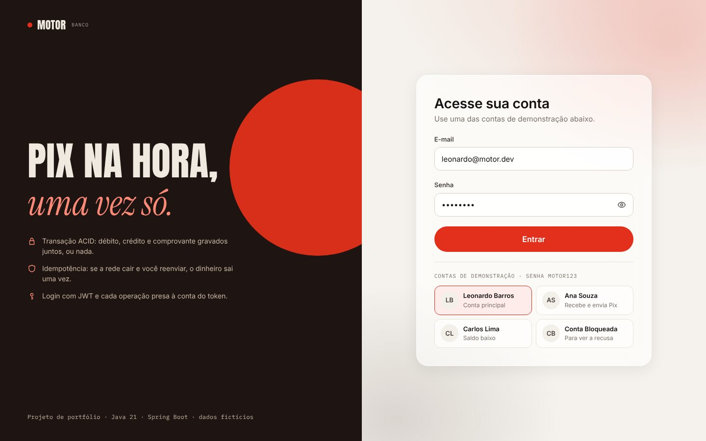
  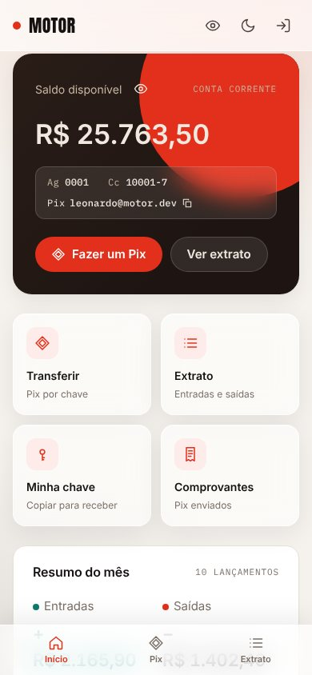
</p>
<p align="center">
  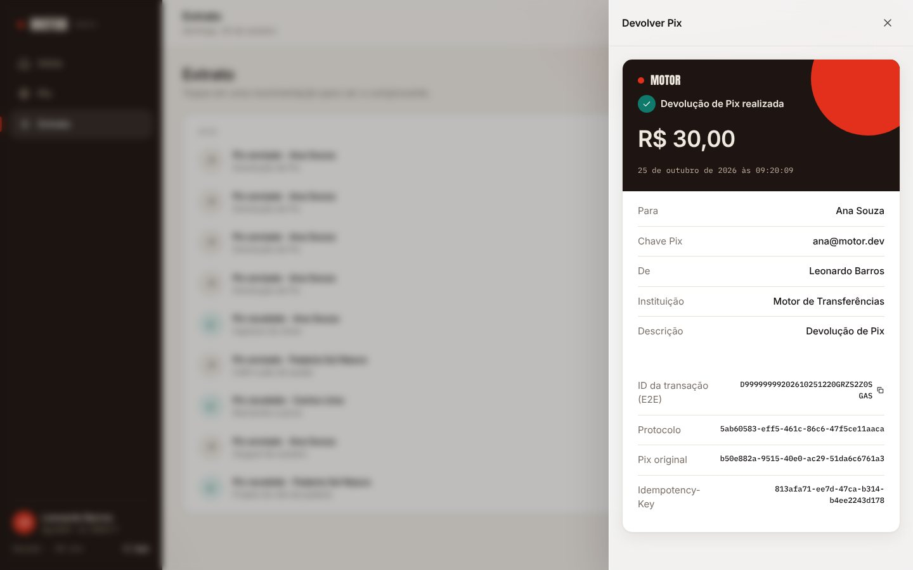
  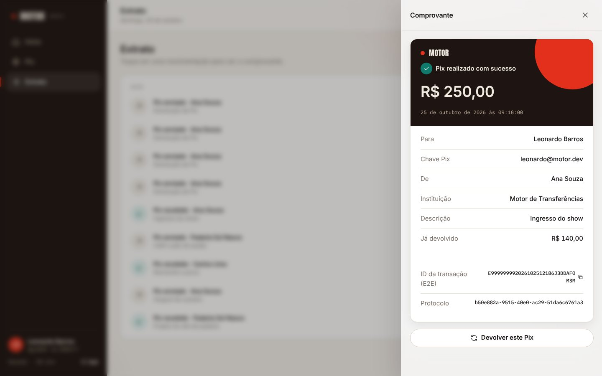
</p>
<p align="center">
  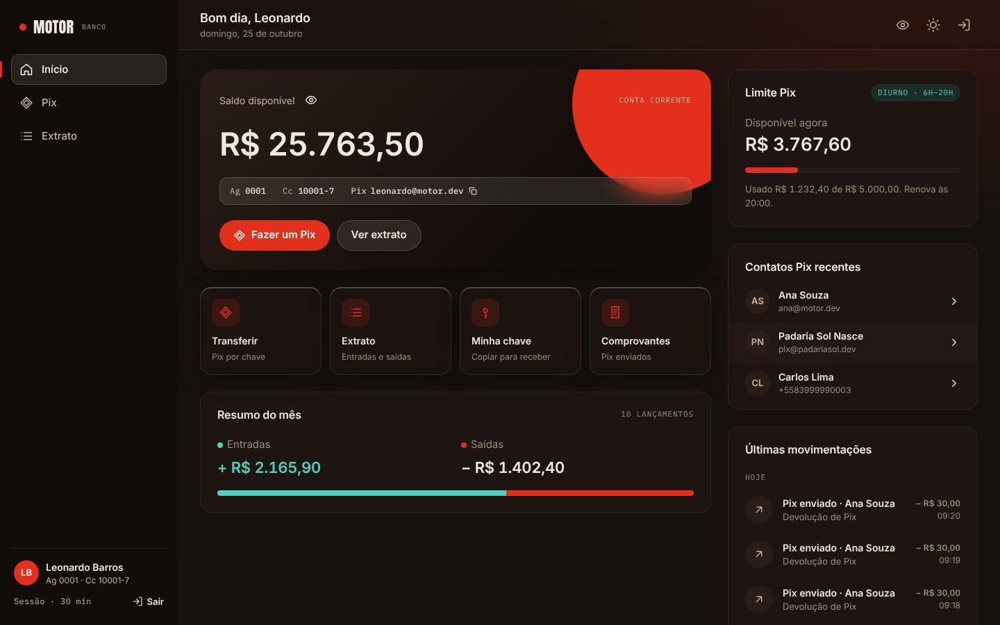
</p>

## Estrutura do repositório

```
motor-transferencias/
├── backend/                                  Spring Boot 4 · Java 21
│   ├── src/main/java/dev/leonardobarros/motor/
│   │   ├── auth/                             User, AuthService, TokenService, @CurrentAccount
│   │   ├── account/                          Account, AccountService, MeController (/me)
│   │   ├── pix/                              PixKeyService, PixController (consulta de chave)
│   │   ├── transfer/                         TransferService (idempotência), TransferProcessor (tx + locks)
│   │   ├── ledger/                           LedgerEntry (partidas dobradas), StatementLine
│   │   ├── outbox/                           OutboxEvent, TransferEventPublisher, OutboxRelay
│   │   ├── shared/                           Money, Problem Details, paginação
│   │   └── config/                           SecurityConfig, CORS, Clock, OpenAPI
│   ├── src/main/resources/db/                migration/ (V1 contas e Pix, V2 usuários, V3 outbox, V4 limites e devoluções) · seed/
│   ├── src/test/java/…                       *Test (unitário, slice) e *IT (Testcontainers)
│   ├── Dockerfile · railway.json · pom.xml · mvnw
├── integracoes/                              microsserviço Spring Boot 4 + Apache Camel 4.23
│   ├── src/main/java/dev/leonardobarros/integracoes/
│   │   ├── rotas/                            RotasPix: as rotas Camel e seus EIPs
│   │   ├── spi/                              Pacs008 e Pacs004 (ISO 20022), MensagensSpi
│   │   ├── notificacao/                      composição e registro das notificações
│   │   ├── conciliacao/                      AggregationStrategy do CSV
│   │   └── evento/ · web/                    contrato consumido, API de consulta
│   └── Dockerfile · pom.xml · mvnw
├── frontend/                                 React 19 · TypeScript · Vite · CSS puro
│   └── src/
│       ├── api/                              cliente HTTP com JWT, sessão, motor de demonstração
│       ├── screens/                          Login, Home, Pix, Statement, TransferDetails
│       ├── components/                       Shell, Receipt, TransactionList, Money, Drawer, Icon
│       ├── hooks/ · lib/                     rotas, preferências, dinheiro em centavos, datas
│       └── styles/                           tokens.css · app.css
├── docs/
│   ├── EVENTOS.md                            contrato dos tópicos Kafka
│   ├── DESIGN.md                             identidade visual
│   ├── adr/                                  decisões de arquitetura
│   └── screenshots/
├── .github/workflows/                        backend.yml · integracoes.yml · frontend.yml
├── docker-compose.yml
└── render.yaml
```

## Limites conhecidos e próximos passos

- [ ] Refresh token rotativo, ou um Authorization Server (Keycloak / Spring Authorization Server)
- [ ] Rate limit no login e na consulta de chave Pix (Bucket4j ou gateway)
- [x] Devolução como nova transferência de sentido contrário, nunca `UPDATE` no livro-razão
- [x] Limites Pix por período e horário
- [ ] Alteração de limite pelo cliente (aumento com carência de 24h, redução imediata)
- [ ] MED completo: bloqueio cautelar e disputa entre bancos
- [ ] Autenticação forte no Pix (MFA, vínculo de dispositivo) e antifraude por comportamento
- [ ] Debezium (CDC) no lugar do polling do outbox
- [ ] Avro/Protobuf com Schema Registry nos eventos
- [ ] Repositório idempotente compartilhado no Camel (JDBC ou Kafka) para rodar várias instâncias
- [ ] Expiração das chaves de idempotência
- [ ] Métricas (Micrometer + Prometheus) e tracing (OpenTelemetry)
- [ ] Teste de carga com k6

---

<div align="center">

Feito por **Leonardo Barros** como projeto de estudo · [MIT](LICENSE) · sem uso real

</div>
